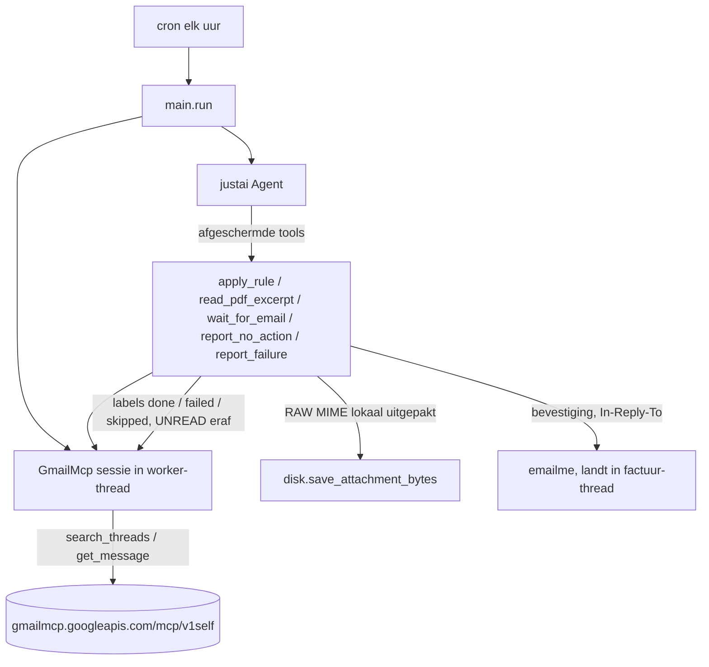
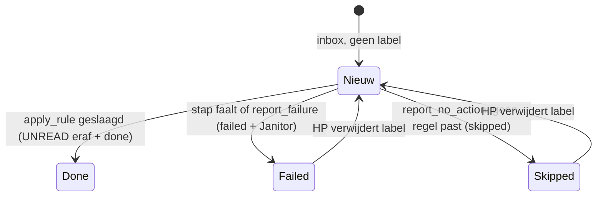

# Gmail via Google Workspace MCP - Plan

## Goal Capsule

- **Objective:** facturen en rapportages blijven na 1 februari 2027 elk uur automatisch op de juiste plek op disk landen, zonder dat het project onder Google's nieuwe regels voor AI-agents op Workspace-data valt of beperkt wordt.
- **Means:** alle Gmail-toegang loopt via Google's officiële Gmail MCP-server, met mailprocessor zelf als MCP-client (KTD1, KTD2, KTD3).
- **Authority:** dit plan; bij conflict wint een R op gedrag en een KTD op mechanisme. Google-documentatie die na 26 nov 2026 verandert, gaat voor op de aannames in Sources.
- **Stop conditions:**
  - U1 toont aan dat bijlage-bytes niet via de MCP-server te krijgen zijn: stop en leg de uitwijkroute uit KTD4 aan de gebruiker voor.
  - De agent-OAuth-client kan niet worden aangemaakt of de MCP-server weigert het token na de setup uit KTD6: stop en meld het.
- **Execution profile:** TDD-first per unit, behalve U1 (spike tegen de echte server) en U6 (live cutover).
- **Deadline:** live voor 1 februari 2027 (handhavingsdatum van Google).
- **Finishing:** HP pusht zelf; deze plan-uitvoering commit lokaal en pusht niet.

---

## Product Contract

### Summary

Mailprocessor stopt met het rechtstreeks aanroepen van de Gmail REST API. Een nieuwe module praat met `https://gmailmcp.googleapis.com/mcp/v1self` via de officiële `mcp` Python SDK. De bestaande, afgeschermde agent-tools (`apply_rule`, `read_pdf_excerpt`, `wait_for_email`, enzovoort) blijven bestaan, maar halen hun Gmail-data voortaan via die MCP-client. Bijlagen komen binnen als RAW MIME en worden lokaal uitgepakt, zodat de bytes nooit in de LLM-context komen. De bevestigingsmail na een opgeslagen factuur gaat via de emailme-dienst en landt via `In-Reply-To`/`References` in de Gmail-thread van de factuur. Mails waarop de agent geen actie neemt krijgen een `mailprocessor/skipped`-label.

### Problem Frame

Google mailde op 24 nov 2026 dat AI-agents en "similar access tools" vanaf 1 feb 2027 via MCP bij Workspace-data moeten, niet via de REST API. Het Workspace AI Tools Addendum zegt dat een access tool die "is or is driven by an AI Agent" een Google MCP moet gebruiken. In mailprocessor roept de justai-agent tools aan die rechtstreeks Gmail REST gebruiken (`src/agent_runner.py`, via `src/gmail_client.py`). Volgens Google worden zulke agents na 1 feb 2027 beperkt tot Standard-quota; contractueel is het een overtreding van het Addendum.

Daarnaast blijft een mail waarop de agent `report_no_action` kiest zonder label staan. Hij komt elk uur terug in de query en gaat elk uur opnieuw naar de LLM (op 23 nov 2026 drie keer achter elkaar).

### Key Decisions

- **Gmail via Google's officiële MCP-server, niet via een omweg zonder agent-tools.** (session-settled: user-directed, chosen over "de agent krijgt geen Gmail-tools en Python haalt alles vooraf op via REST": de gebruiker wil de MCP-route, meer bouwwerk is acceptabel.) Governs R1, R2.
- **Handmatige stappen in de Google-interface minimaliseren.** (session-settled: user-directed, chosen over een setup die op de Cloud Console leunt: liever gcloud en scripts.) Governs R7.

### Requirements

**Compliance**

- R1. Geen enkele code in mailprocessor roept nog de Gmail REST API aan; alle Gmail-toegang loopt via `gmailmcp.googleapis.com`.
- R2. De agent krijgt geen ruwe MCP-tools; hij ziet alleen de bestaande, afgeschermde tools (geen versturen, verwijderen of doorsturen door het model).
- R3. Bijlage-bytes komen nooit in de LLM-context; ze gaan van de MCP-response via `disk.save_attachment_bytes` naar disk, met de bestaande `ALLOWED_ROOTS`- en vergelijkingsregels.

**Gedrag**

- R4. Alle huidige regels in `tasks.md` blijven werken: bijlage opslaan, gedownloade PDF opslaan (browser-flow), 2FA-code uit een binnenkomende mail lezen.
- R5. Na een geslaagde verwerking krijgt HP een bevestiging met regel, opgeslagen paden en een Gmail-link; de mail wordt gelezen gemarkeerd en krijgt `mailprocessor/done`.
- R6. Een mail waarvoor geen regel uit `tasks.md` past krijgt `mailprocessor/skipped` en komt niet meer terug in de query; herverwerken gaat door het label te verwijderen. Een fout tijdens de verwerking valt onder R9, niet onder skipped.

**Bediening**

- R7. De setup vraagt hooguit een handmatige Console-stap (de agent-OAuth-client); de rest gaat via `gcloud` of een subcommando van `main.py`.
- R8. Het script blijft onbeheerd draaien vanuit cron; geen stap vraagt na de setup nog interactieve goedkeuring.
- R9. Fouten blijven bij Janitor komen: tijdelijke MCP-fouten geven een WARNING per retry en pas na de laatste poging een ERROR.

### Scope Boundaries

- Geen MCP-ondersteuning in justai zelf; mailprocessor bouwt een eigen, kleine client.
- Geen wijziging aan de browser-tools (`src/browser_tools.py`); die raken Gmail niet.
- Geen Scaled tier: het verbruik blijft ruim onder de Standard-limiet van 5.000 requests per dag.

### Deferred to Follow-Up Work

- Generieke MCP-client in justai, zodat andere projecten (janitor, golfmeester) dezelfde brug kunnen gebruiken. Trigger: een tweede project heeft MCP nodig.
- De oude kopie `/Users/hp/proj/research/mailprocessor` opruimen in de research-repo. Trigger: na U6, los van deze repo.
- Het oude, niet-agentic OAuth-client-ID verwijderen in de Console. Trigger: twee weken stabiel draaien na U6.

---

## Planning Contract

### Key Technical Decisions

- KTD1. **Endpoint `/mcp/v1self`, niet `/mcp/v1`.** `/mcp/v1` vraagt bij gevoelige acties goedkeuring via MCP elicitation, en "always allow" werkt alleen interactief en verloopt na 90 dagen. Dat breekt R8. `/mcp/v1self` heeft geen elicitation en bevat alle lees- en label-tools die we nodig hebben; alleen `reply`, `send_message` en `forward` ontbreken (zie KTD5). Volgt uit de Key Decision MCP-route; governs R1, R8.
- KTD2. **Mailprocessor is zelf de MCP-client, achter de bestaande tool-closures.** Een nieuwe module `src/gmail_mcp.py` biedt dezelfde methoden die `agent_runner` nu van `GmailClient` gebruikt. De agent ziet geen MCP-schema's. Afgewezen: ruwe MCP-tools aan de agent geven (geeft het model schrijfrechten en vergroot het prompt-injectierisico, strijdig met R2), MCP in justai inbouwen (raakt elk project, justai voert tools synchroon uit en heeft geen MCP-pad), en OpenAI's native remote-MCP (justai stuurt alleen `function`-tools door, Google-tokens zouden bij OpenAI belanden, geen elicitation).
- KTD3. **Ook de deterministische code gaat via MCP.** Het Addendum spreekt van "driven by an AI Agent" en zegt niet dat REST-calls zonder LLM in hetzelfde project buiten schot blijven. De veilige lezing is een enkele client voor alles; daarmee verdwijnt `google-api-python-client` uit de dependencies. Governs R1.
- KTD4. **Bijlagen via `get_message` met formaat `RAW`, lokaal uitgepakt.** Geen MCP-tool levert bijlage-bytes los; `get_message` geeft per bijlage alleen metadata. `RAW` geeft de volledige MIME-tekst, die Python met de stdlib `email`-parser uitpakt en direct aan `disk.save_attachment_bytes` geeft. De LLM krijgt alleen bestandsnamen en statusregels. Een RAW-bericht bevat geen Gmail-bijlage-ID's, dus `MailContext.attachment_ids` slaat per bestandsnaam het `partId` uit de metadata van `get_message` op; `download_attachment` loopt het geparste RAW-bericht af in Gmail's partId-nummering (`0`, `1`, `1.2`, ...) en geeft de gedecodeerde inhoud van dat deel terug. Of `RAW` de bijlagen volledig en zonder groottebeperking teruggeeft, is niet geverifieerd: U1 bewijst het met een echte factuurmail. Uitwijkroute als het niet werkt: bijlagen downloaden met een REST-call uit deterministische code, buiten de agent om. Dat is de grijze zone van het Addendum en vraagt eerst een besluit van de gebruiker (stop condition). Governs R3.
- KTD5. **Bevestiging via de emailme-dienst, als antwoord in de factuur-thread.** Op `/mcp/v1self` bestaat versturen niet, en op `/mcp/v1` vraagt het interactieve goedkeuring (KTD1). De bevestiging gaat als JSON-POST naar `https://www.harmsen.nl/emailme/` met `X-Emailme-Token` (`EMAILME_TOKEN` staat al in `.env`). De URL moet de www-variant zijn: `harmsen.nl` antwoordt met een 301 en de redirect maakt van de POST een lege GET, waarna emailme een mail "No subject" verstuurt. Inhoud zoals nu (`_format_reply_body`) plus de Gmail-deeplink, onderwerp `Re: <origineel onderwerp>`, en via het `headers`-veld van emailme `In-Reply-To` en `References` gelijk aan de `Message-ID` van de factuurmail. Gmail zet zo'n mail in de bestaande thread (geverifieerd op 2026-11-27 met een factuur van Apex). emailme zelf hoeft niet te veranderen. Ontbreekt de `Message-ID`, dan gaat de bevestiging zonder die headers en wordt het een losse mail. Governs R5, R8.
- KTD6. **Een nieuwe Desktop OAuth-client met de agent-vlag, in hetzelfde project.** De MCP-servers weigeren clients zonder "Use this client for an AI-powered agent" (fout `invalid token`). Volgens de release notes kan een client die op 12 nov 2026 niet gemarkeerd was dat niet meer worden; de Cloud Help spreekt dat tegen, dus een nieuwe client is de zekere route. Die vlag zetten kan alleen in de Console: dit is de enige handmatige stap (R7). Het aanzetten van de API gaat met `gcloud services enable gmailmcp.googleapis.com --project=mailprocessor-499408`. Scope blijft `gmail.modify`. Het token komt via de bestaande `InstalledAppFlow` in `setup-auth`; `google-auth` ververst het en de client stuurt het mee als `Authorization: Bearer`. Governs R7.
- KTD7. **Synchrone brug via een eigen worker-thread met event loop.** De `mcp` SDK is async; justai roept tools synchroon aan (`func(**kwargs)`) binnen een al draaiende loop. `gmail_mcp.py` houdt een MCP-sessie open in een achtergrondthread en biedt synchrone methoden, naar het patroon van `BrowserSession` in `src/browser_tools.py`. Een sessie per run, niet per call.
- KTD8. **Gelezen markeren is `UNREAD` verwijderen.** Er is geen aparte tool; `update_message_labels` met `UNREAD` in de te verwijderen labels is de verwachte route. U1 verifieert dit.
- KTD9. **Label `mailprocessor/skipped` alleen als geen regel past; fouten via een eigen tool.** De huidige prompt laat de agent `report_no_action` ook aanroepen bij fouten (knop niet gevonden, time-out). Met een skipped-label zou zo'n factuur stil verdwijnen. Daarom splitst U3 dit: `report_no_action` zet het skipped-label en is alleen voor "geen regel past"; een nieuwe tool `report_failure` loopt via `_fail` (failed-label plus Janitor). De query sluit skipped uit naast `done` en `failed`; `ensure_labels` maakt het aan. Governs R6, R9.
- KTD11. **Zoekresultaten per bericht filteren.** `search_threads` is de enige zoek-tool en geeft hele threads terug, inclusief berichten die niet aan de query voldoen. Maandfacturen en 2FA-mails van een afzender belanden vaak in een thread. `query_pending` filtert daarom lokaal per bericht op labels (INBOX aanwezig; `done`, `failed`, `skipped` afwezig) en afzender. `wait_for_email` filtert ook op ontvangsttijd na het starttijdstip en kiest het nieuwste bericht. Governs R4, R6.
- KTD10. **Pollen in `wait_for_email` met tussenpozen van 10 seconden.** `search_threads` telt als 10 requests. Elke 10 seconden gedurende maximaal 120 seconden kost hooguit 120 requests per 2FA-flow, ruim binnen 5.000 per dag. Nu is het elke 5 seconden.

### High-Level Technical Design

Datastroom per run na de ombouw:

Labelstatus per mail:

### Assumptions

- De Gmail MCP-server is GA (24 nov 2026) en binnen 10 dagen zichtbaar voor het harmsen.nl-account.
- Het Workspace-beheer van harmsen.nl staat MCP-toegang toe (Admin console, Security, API Controls). Zo niet, dan is dat een tweede handmatige stap; U1 stelt het vast.
- De emailme-dienst op `https://www.harmsen.nl/emailme/` kan vanuit mailprocessor mailen en zet extra headers door als `X-Emailme-Token` klopt; hij wordt nu al gebruikt voor de Janitor-handler.
- Gedownloade bijlagen zelf (facturen op disk) zijn het doel van de tool en vallen onder normaal gebruik; het Addendum noemt geen bewaartermijn voor zulke bestanden. Logs bevatten afzender en onderwerp en roteren al op grootte.

### Sequencing

U1 is een harde poort: pas als de spike bewijst dat RAW-bijlagen, label-tools en auth werken, begint de bouw. Daarna lineair: client (U2), agent-runner (U3), main en opruimen (U4), docs (U5), live cutover (U6). De oude REST-route blijft draaien tot U6.

---

## Implementation Units

| # | Task | Touches | Depends on |
|---|------|---------|------------|
| 01 | U1. Spike en setup tegen de echte MCP-server | `scripts/mcp_probe.py`, `src/main.py`, `.gitignore`, `docs/solutions/integrations/gmail-mcp-setup.md` | - |
| 02 | U2. GmailMcp-client met synchrone brug | `src/gmail_mcp.py`, `tests/test_gmail_mcp.py`, `tests/fixtures/mcp/*`, `pyproject.toml`, `uv.lock` | 01 |
| 03 | U3. Agent-runner op GmailMcp, emailme-bevestiging, skipped-label | `src/agent_runner.py`, `tests/test_agent_runner.py` | 02 |
| 04 | U4. main.py omzetten en REST-code verwijderen | `src/main.py`, `src/gmail_client.py`, `tests/test_gmail_client.py`, `tests/fixtures/*_message.json`, `pyproject.toml`, `uv.lock` | 01, 02, 03 |
| 05 | U5. Documentatie bijwerken | `docs/architecture.md`, `README.md`, `tasks.md.example` | 03, 04 |
| 06 | U6. Live cutover en controle | geen code; `credentials*.json`, `token*.json` lokaal | 05 |

### U1. Spike en setup tegen de echte MCP-server

- **Goal:** vaststellen dat de MCP-route werkt voordat er gebouwd wordt, en de eenmalige setup vastleggen.
- **Requirements:** R3, R7, KTD4, KTD6, KTD8.
- **Dependencies:** geen.
- **Files:** `scripts/mcp_probe.py` (nieuw), `src/main.py` (`setup-auth` krijgt een optie voor het nieuwe client-bestand), `.gitignore` (`credentials_mcp.json`, `token_mcp.json`), `docs/solutions/integrations/gmail-mcp-setup.md` (nieuw).
- **Approach:**
  1. `gcloud services enable gmail.googleapis.com gmailmcp.googleapis.com --project=mailprocessor-499408`.
  2. HP maakt in de Console een Desktop OAuth-client met de agent-vlag en downloadt de JSON als `credentials_mcp.json` (de enige handmatige stap; de stappen staan uitgeschreven in het solutions-document).
  3. `setup-auth` voor het nieuwe bestand levert `token_mcp.json`; de oude `credentials.json` en `token.json` blijven onaangeroerd, zodat de cron doorloopt.
  4. Het probe-script verbindt met `/mcp/v1self` en toont de toollijst. Het haalt in `RAW` de factuurmail met de grootste bijlage van de gevolgde afzenders op, plus een mail met meerdere bijlagen. Het pakt de bijlagen uit via de partId-koppeling (KTD4) en vergelijkt de bytes met de bestanden die de huidige route eerder opsloeg. De RAW-grootte per mail gaat in het solutions-document.
  5. Het script zoekt met `search_threads` op een afzender met een thread van meerdere berichten en legt vast hoeveel berichten per thread terugkomen en met welke labels (KTD11).
  6. Het script maakt een testlabel, zet en verwijdert het op een testmail, en haalt `UNREAD` weg en zet het terug.
  7. Het script stelt vast welk formaat van `get_message` de `Message-ID`-header levert. Zit hij alleen in `RAW`, dan legt het vast hoe groot die response is voor een mail zonder bijlage (KTD5).
  8. Uitkomsten (toolnamen, argumentvormen, grootte van de RAW-response, eventuele fouten) komen in het solutions-document.
- **Execution note:** dit is een spike tegen de echte server; bewijs met een draaiend script, niet met unit-tests. Breekt stap 4, dan geldt de stop condition uit de Goal Capsule.
- **Patterns to follow:** `run_oauth_flow` en `load_credentials` in `src/gmail_client.py`; de token-chmod 600.
- **Test expectation:** none -- spike en configuratie; het bewijs is de probe-uitvoer in het solutions-document.
- **Verification:** de probe-uitvoer toont identieke bijlage-bytes, een gelukte label-wijziging en een gelukte `UNREAD`-wijziging, en de cron heeft intussen normaal gedraaid.

### U2. GmailMcp-client met synchrone brug

- **Goal:** een module die alle Gmail-operaties van mailprocessor via MCP levert, met dezelfde methoden die `agent_runner` en `main` nu gebruiken.
- **Requirements:** R1, R3, R9, KTD1, KTD3, KTD4, KTD7, KTD8, KTD9, KTD10, KTD11.
- **Dependencies:** U1.
- **Files:** `src/gmail_mcp.py` (nieuw), `tests/test_gmail_mcp.py` (nieuw), `tests/fixtures/mcp/` (MCP-responses uit de U1-probe, geanonimiseerd), `pyproject.toml` en `uv.lock` (`mcp` toevoegen, versie gepind).
- **Approach:**
  1. Een klasse die bij openen het token laadt en ververst, een MCP-sessie start in een worker-thread (KTD7) en bij sluiten netjes afbouwt.
  2. Methoden: `query_pending` (inclusief `-label:skipped`, met filtering per bericht uit KTD11), `get_message`, `get_message_body`, `download_attachment` (RAW ophalen, MIME uitpakken, het deel met het gevraagde partId teruggeven, KTD4), `ensure_labels` (inclusief skipped), `add_label`, `mark_read`, `wait_for_email` (interval 10 seconden, nieuwste bericht na het starttijdstip). `get_message` vult `message_id_header` in `MailContext` uit het formaat dat U1 vaststelde; als dat `RAW` is, worden alleen de headers geparsed.
  3. Labelnamen worden een keer per run naar ID's vertaald, omdat de label-tools ID's verwachten.
  4. De CRLF-check op het From-adres en `InvalidSenderError` verhuizen mee uit `gmail_client.py`.
  5. Retry op tijdelijke fouten (netwerk, 429, 5xx): WARNING per poging, ERROR na de laatste (R9).
- **Execution note:** test-first tegen een nep-MCP-sessie die de vastgelegde U1-responses teruggeeft.
- **Patterns to follow:** `_execute`-retry en de From-header-guard in `src/gmail_client.py`; worker-thread in `BrowserSession` (`src/browser_tools.py`).
- **Test scenarios:**
  - `query_pending` met drie afzenders bouwt een query die `done`, `failed` en `skipped` uitsluit en geeft de message-ID's terug.
  - `query_pending` op een thread met een `done`-bericht en een nieuw bericht geeft alleen het nieuwe bericht terug.
  - `wait_for_email` op een thread met een oude en een nieuwe 2FA-mail geeft de body van de nieuwe terug.
  - `get_message` op een normale factuurmail levert een `MailContext` met afzender, onderwerp, datum en bijlage-ID's.
  - `get_message` met een From-header die `\r\n` bevat gooit `InvalidSenderError`.
  - `get_message` levert de `Message-ID` van de mail in `message_id_header`, en `None` als de header ontbreekt.
  - `download_attachment` op een RAW-fixture met een PDF levert exact de PDF-bytes.
  - `download_attachment` op een mail met twee bijlagen levert de juiste bij elk ID.
  - `download_attachment` voor een onbekend ID gooit een duidelijke fout, geen lege bytes.
  - `ensure_labels` maakt ontbrekende labels aan en hergebruikt bestaande.
  - `mark_read` stuurt een labelwijziging die alleen `UNREAD` verwijdert.
  - `wait_for_email` vindt een mail na de tweede poll en geeft de body terug.
  - `wait_for_email` geeft na 120 seconden zonder resultaat een time-out, met een nepklok.
  - Een tijdelijke fout bij de eerste poging en succes bij de tweede logt een WARNING en geen ERROR.
  - Aanhoudende fouten loggen na de laatste poging precies een ERROR en gooien de fout door.
  - Een verlopen token wordt ververst voordat de sessie start.
- **Verification:** alle nieuwe tests groen; de module importeert geen `googleapiclient`.

### U3. Agent-runner op GmailMcp, emailme-bevestiging, skipped-label

- **Goal:** de agent-tools gebruiken GmailMcp, de bevestiging gaat via emailme, no-action zet het skipped-label en fouten gaan naar failed.
- **Requirements:** R2, R3, R4, R5, R6, R9, KTD2, KTD5, KTD9.
- **Dependencies:** U2.
- **Files:** `src/agent_runner.py`, `tests/test_agent_runner.py`.
- **Approach:**
  1. Type-hints en imports van `GmailClient` naar `GmailMcp`. De bestaande tool-namen blijven gelijk, zodat `tasks.md` niet hoeft te veranderen. De docstrings en prompttekst van `report_no_action`, `apply_rule` en `apply_downloaded` worden bijgewerkt naar het nieuwe gedrag, want justai stuurt ze als toolbeschrijving naar het model.
  2. In `apply_rule` en `apply_downloaded` vervangt een emailme-bevestiging de stap `send_reply` (KTD5: www-URL, onderwerp `Re: ...`, `In-Reply-To` en `References` uit `mail_ctx.message_id_header`); de stapnaam in de failure-rapportage wordt `confirm`.
  3. `report_no_action` wordt een closure met `gmail` en `mail_ctx` die het skipped-label zet en een reden logt; de prompt beperkt hem tot "geen regel past" (KTD9).
  4. Nieuwe tool `report_failure(reason)` die `_fail` aanroept (failed-label plus Janitor); de prompt verwijst fouten zoals een ontbrekende knop of time-out hiernaartoe (KTD9).
  5. `read_pdf_excerpt` blijft maximaal 2000 tekens PDF-tekst teruggeven; de bytes zelf gaan nooit in een tool-resultaat (R3).
- **Execution note:** pas eerst de bestaande tests aan op het nieuwe gedrag en zie ze falen.
- **Patterns to follow:** bestaande closures `make_apply_rule` en `_fail`; `_format_reply_body` voor de bevestigingstekst.
- **Test scenarios:**
  - `apply_rule` met een geldige bijlage slaat het bestand op, stuurt een emailme-bevestiging met regel, pad en Gmail-link, markeert gelezen en zet `done`.
  - De emailme-request gaat naar `https://www.harmsen.nl/emailme/`, met onderwerp `Re: <onderwerp>` en `In-Reply-To` en `References` gelijk aan de `Message-ID` van de factuur.
  - Zonder `message_id_header` gaat de bevestiging zonder die headers en slaagt de verwerking gewoon.
  - Een onderwerp dat al met `Re:` begint krijgt geen tweede `Re:`.
  - `apply_rule` waarbij emailme faalt zet `failed`, meldt aan Janitor met stap `confirm` en zet geen `done`.
  - `apply_rule` met een doelpad buiten `ALLOWED_ROOTS` zet `failed` en stuurt geen bevestiging.
  - `apply_rule` met een bestaand bestand met dezelfde bytes geeft `identical-already-present` en gaat door.
  - `apply_downloaded` volgt dezelfde bevestigingsroute als `apply_rule`.
  - `report_no_action` zet `mailprocessor/skipped` en geen ander label.
  - `report_failure` na een browser-time-out zet `mailprocessor/failed`, meldt aan Janitor en zet geen skipped-label.
  - Geen enkel tool-resultaat dat naar de agent teruggaat bevat bijlage-bytes of base64.
  - `process_mail` geeft de agent de bestaande toolnamen plus `report_failure`.
- **Verification:** alle agent-runner-tests groen; `send_reply` komt nergens meer voor in `src/`.

### U4. main.py omzetten en REST-code verwijderen

- **Goal:** `main.py` draait volledig op GmailMcp en de REST-code is weg.
- **Requirements:** R1, R7, R8, R9, KTD3, KTD6.
- **Dependencies:** U1, U2, U3.
- **Files:** `src/main.py`, `src/gmail_client.py` (verwijderen), `tests/test_gmail_client.py` (verwijderen), `tests/fixtures/*_message.json` (verwijderen voor zover alleen door REST-tests gebruikt), `pyproject.toml` en `uv.lock` (`google-api-python-client` eruit; `google-auth` en `google-auth-oauthlib` blijven).
- **Approach:**
  1. `run()` opent een GmailMcp-sessie, doet `ensure_labels`, `query_pending` en `get_message`, en sluit de sessie aan het eind, ook bij fouten.
  2. `setup-auth` werkt op `credentials_mcp.json` en `token_mcp.json`; de padnamen staan bovenin `main.py`, zoals nu.
  3. Een tokenfout geeft een ERROR met de actie "run setup-auth", zoals nu.
  4. `GMAIL_DEEPLINK` en `NOTIFY_TO` verhuizen naar een plek die zonder `gmail_client` te importeren is.
- **Execution note:** verwijder `gmail_client.py` pas als de volledige testsuite groen is zonder imports ervan.
- **Patterns to follow:** de huidige import-guard en foutafhandeling in `src/main.py`.
- **Test scenarios:**
  - Een run met twee pending mails roept per mail `process_mail` aan en sluit daarna de sessie.
  - Een run waarin de sessie niet opent (tokenfout) logt een ERROR met "setup-auth" en eindigt met exitcode 1.
  - Een run zonder pending mails sluit de sessie en verwerkt niets.
  - Geen module in `src/` importeert `googleapiclient` (test over de bronbestanden).
- **Verification:** volledige testsuite groen; `uv sync` op een schone venv installeert geen `google-api-python-client`.

### U5. Documentatie bijwerken

- **Goal:** de docs beschrijven de MCP-route, het skipped-label en de nieuwe setup.
- **Requirements:** R6, R7.
- **Dependencies:** U3, U4.
- **Files:** `docs/architecture.md`, `README.md`, `tasks.md.example`.
- **Approach:**
  1. `architecture.md`: runtime flow, state-transitions (met skipped), security-tabel (agent-OAuth-client, geen bytes naar de LLM), externe afhankelijkheden (`mcp`, Gmail MCP-server), en de verouderde verwijzing naar `query_unread` corrigeren.
  2. `README.md`: setup volgens het solutions-document uit U1, verwijzingen naar `/Users/hp/proj/research/mailprocessor` weghalen.
  3. `tasks.md.example`: alleen bijwerken als toolnamen of het 2FA-interval in de tekst staan.
- **Test expectation:** none -- alleen documentatie.
- **Verification:** geen verwijzing meer naar REST-calls, `send_reply` of het research-pad in deze bestanden.

### U6. Live cutover en controle

- **Goal:** de cron draait op de MCP-route en het verbruik is gecontroleerd.
- **Requirements:** R4, R5, R6, R8, R9.
- **Dependencies:** U5.
- **Files:** geen code; lokaal worden `credentials.json` en `token.json` naar een backup verplaatst.
- **Approach:**
  1. Een handmatige run van `uv run src/main.py` met een echte factuurmail in de inbox.
  2. Daarna twee dagen cron-runs volgen in `~/Library/Logs/mailprocessor/app.log` en bij Janitor.
  3. In het Workspace API usage-dashboard nagaan dat project `mailprocessor-499408` ruim onder de Standard-limiet zit.
  4. Eventuele hangende no-action-mails in de inbox krijgen bij de eerste run het skipped-label; HP kijkt die lijst een keer na.
- **Test expectation:** none -- live verificatie.
- **Verification:** een factuur staat op disk, de bevestiging staat via emailme in de Gmail-thread van de factuur, de mail heeft `done`, en er zijn geen nieuwe Janitor-meldingen na twee dagen.

---

## Verification Contract

| Gate | Commando of check | Wanneer |
|---|---|---|
| Unit-tests | `uv run pytest` | na elke unit vanaf U2 |
| Geen REST meer | zoeken naar `googleapiclient` en `gmail.googleapis.com/gmail/v1` in `src/` levert niets op | na U4 |
| Spike-bewijs | probe-uitvoer in `docs/solutions/integrations/gmail-mcp-setup.md` toont identieke bijlage-bytes en geslaagde labelwijzigingen | na U1 |
| Live run | handmatige run plus twee dagen cron zonder Janitor-meldingen | U6 |
| Verbruik | Workspace API usage-dashboard: ruim onder 5.000 requests per dag | U6 |

## Definition of Done

- Alle units U1 tot en met U6 zijn uitgevoerd en hun Verification-regel klopt.
- R1 tot en met R9 zijn aantoonbaar waar; R1 en R3 met een test of zoekopdracht, R4 tot en met R6 in de live run.
- `src/gmail_client.py`, de REST-tests en `google-api-python-client` zijn weg.
- Er staat geen probe- of experimentcode in `src/`; `scripts/mcp_probe.py` blijft alleen als diagnosehulp en wordt in de README genoemd.
- De oude `credentials.json` en `token.json` staan niet meer in de projectmap.

---

## Risks & Dependencies

| Risico | Gevolg | Mitigatie |
|---|---|---|
| RAW levert bijlagen niet volledig of te groot | R3 onhaalbaar via MCP | U1 als poort; uitwijkroute in KTD4 alleen na besluit van HP |
| Workspace-beheer blokkeert MCP voor het domein | `403` of `invalid token` | U1 stelt het vast; aanzetten in Admin console, Security, API Controls |
| Nieuwe agent-client werkt pas na de GA-uitrol (tot 10 dagen) | U1 loopt vertraging op | U1 vroeg starten; ruim voor 1 feb 2027 |
| `mcp` SDK v2 heeft breaking changes ten opzichte van v1-voorbeelden | Verbindingscode werkt niet | Versie pinnen; de migratiegids volgen |
| Prompt-injectie via mailinhoud | Agent doet iets onbedoelds | Agent houdt alleen afgeschermde tools (R2); `ALLOWED_ROOTS` blijft |

## Sources & Research

- Google: [Configure the Google Workspace MCP servers](https://developers.google.com/workspace/guides/configure-mcp-servers), [Gmail MCP-tools](https://developers.google.com/workspace/gmail/api/reference/mcp), [get_message](https://developers.google.com/workspace/gmail/api/reference/mcp/tools_list/get_message), [Gmail MCP-setup](https://developers.google.com/workspace/gmail/api/guides/configure-mcp-server), [release notes](https://developers.google.com/workspace/release-notes), [quotas](https://developers.google.com/workspace/gmail/api/guides/quotas), [tools-safety](https://developers.google.com/workspace/tools-safety), [Workspace AI Tools Addendum](https://workspace.google.com/terms/ai-tools), [Cloud Help over de agent-vlag](https://support.google.com/cloud/answer/15549257).
- MCP Python SDK: [python-sdk](https://github.com/modelcontextprotocol/python-sdk), [migratiegids v2](https://py.sdk.modelcontextprotocol.io/migration/).
- Code: `src/agent_runner.py` (toolset en closures), `src/gmail_client.py` (REST-calls, retry, From-guard), `src/browser_tools.py` (`BrowserSession` worker-thread), `src/disk.py` (`ALLOWED_ROOTS`, byte-vergelijking).
- justai 5.8.6 heeft geen MCP-pad en voert tools synchroon uit (`justai/agent/agent.py`); de OpenAI-route stuurt alleen `function`-tools door (`justai/models/openai_responses.py`).
- Niet geverifieerd en daarom in U1: volledigheid van RAW-bijlagen, `UNREAD` verwijderen via `update_message_labels`, exacte v2-signatures voor headers in de `mcp` SDK.
